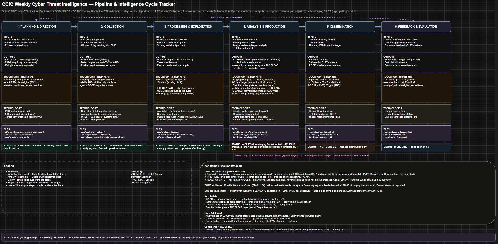

<p align="center">
  
</p>

<h1 align="center">Sanctum</h1>

<p align="center"><em>"Ave Omnissiah"</em></p>

Sanctum runs the first three steps of the intelligence cycle for any subject you decide upon in Planning and Direction (pnd.yaml). It then uses a predefined set of sensors (opensource resources) to collect on that subject, scores what it finds, and hands you a reviewable document. You conduct Analysis and Production, Dissemination, and Feedback and Evaluation on your own, but the output of that work should inform Planning and Direction.

The engine core of Sanctum is subject agnostic. Everything specific to a subject, the sources, what matters and how much, the shape of the output, all live in one configuration file (pnd.yaml). Swap that file and the same code runs on a different subject.

All work is unclassified open-source material.

## What it does

1. **Collects** from the sources you list, pulls the full text, removes duplicates, and keeps everything permanently.
2. **Scores** what it collected against your priorities, showing its reasoning for every item, and listing everything it set aside.
3. **Refines** the result into a readable document — the **vox** — with a person deciding every entry.

Then it stops. Assessment, distribution and feedback are yours.



## Doctrine

Eight rules govern every decision here.

1. **The engine knows nothing about any subject.** One configuration file per subject is the only thing that changes, and it declares settings — it never contains logic.
2. **Human in the loop.** A person decides every item — the score only puts them in order. Nothing in the code calls a language model or spends a token.
3. **Nothing is hidden.** Every item shows why it scored what it did, and everything set aside is still listed by name.
4. **Show everything that qualifies; narrow later.** The number of items is a result, not a target. If the output is too big, change the priorities — never cap the list.
5. **Be picky about sources, not about articles.** Drop a noisy source without hesitation; keep the marginal article from a good one.
6. **It stops at the vox.** Sanctum prepares; it does not conclude.
7. **Keep it small.** Don't build until something needs it. Delete what has stopped being used — leftovers mislead whoever reads them next.
8. **Nothing identifying goes in the repo.** No secrets, no personal or infrastructure detail. Verify rather than assume; changes that alter behaviour are proven by tests.

## Choosing what it watches

Everything is set in one place: a subject's **Planning & Direction** file. Sources, priorities and weights, how far back to look, how often to run, and what the output is called.

That includes the schedule. Sanctum has no built-in cadence — weekly, monthly or on demand are all just settings.

```
./run.sh <subject>
```

## Where to go next

| If you want to | Read |
|---|---|
| Run it, or understand the engine | [`core/README.md`](core/README.md) |
| Set up a new subject **(in development)** | [`docs/DOMAINS.md`](docs/DOMAINS.md) |
| Build or maintain its word lists | [`docs/VOCABULARY.md`](docs/VOCABULARY.md) |
| Turn the scored output into a vox | [`docs/EXPLOITATION.md`](docs/EXPLOITATION.md) |

A worked example lives in `cti/` — a weekly cyber threat brief for local government. It is the pattern to copy; there is no separate starter template, because one that lags the working domain teaches the wrong shape.

## License / use

Unclassified, open-source methodology. Use it, fork it, point it at your own subject.
